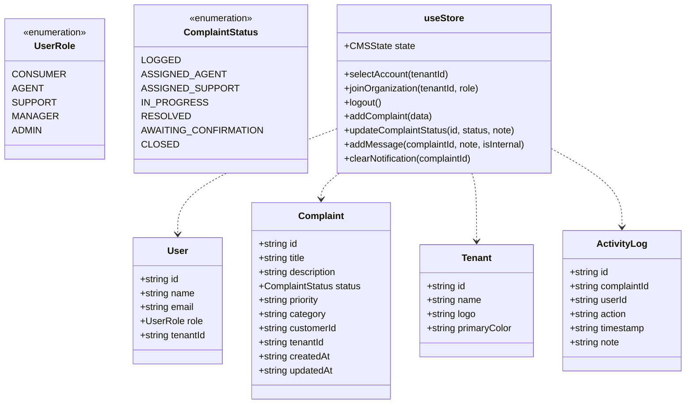

# ResolvePro CMS - C4 Architecture Diagrams

## Level 1: System Context Diagram
... (existing content)

## Level 2: Container Diagram
... (existing content)

## Level 3: Component Diagram (Web Application)
... (existing content)

## Level 4: Code Structural Diagram
This diagram details the full domain model and the state store API.



## Level 4: Code Behavioural Diagram
This diagram illustrates the detailed execution flow for logging a new complaint.

```mermaid
sequenceDiagram
    participant U as User
    participant P as NewComplaint Page
    participant S as useStore
    participant L as Internal Logic
    participant D as Supabase DB
    participant T as Toast Utility

    U->>P: Submit Form
    P->>P: Set Loading(true)
    P->>S: addComplaint(data)
    S->>L: generateShortId()
    L-->>S: "ABC123XY"
    S->>D: INSERT complaint
    D-->>S: Success
    S->>S: fetchData(tenantId)
    S->>D: SELECT complaints & logs
    D-->>S: Data Arrays
    S->>S: setState(newArrays)
    S-->>P: Done
    P->>T: showSuccess()
    P->>P: navigate('/complaints')